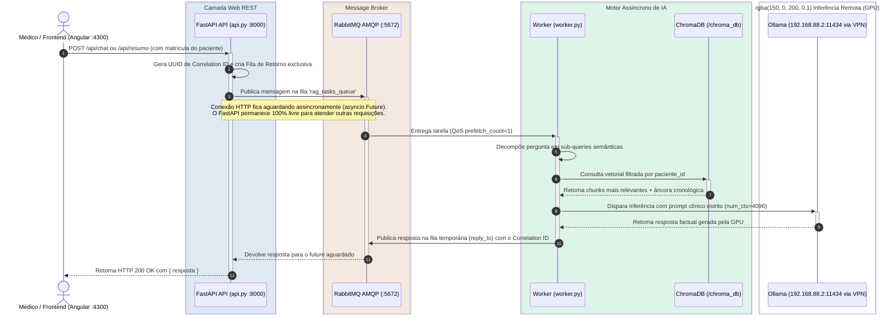

# RAG Prontuário Médico - Guia Mestre de Engenharia & Transição Técnica (Handover)

Sistema corporativo de **Retrieval-Augmented Generation (RAG)** e inteligência clínica para consulta semântica, geração de resumos estruturados e ingestão contínua de prontuários médicos eletrônicos.

Este documento serve como o **manual de transição técnica** definitivo para que qualquer novo engenheiro de software, cientista de dados ou desenvolvedor de IA assuma a operação, manutenção e evolução do projeto sem atritos.

---

## 📑 Índice
1. [Visão Geral & Valor Clínico](#-visão-geral--valor-clínico)
2. [Arquitetura do Sistema & Fluxo de Mensageria](#-arquitetura-do-sistema--fluxo-de-mensageria)
3. [Repositórios & Componentes Envolvidos](#-repositórios--componentes-envolvidos)
4. [Infraestrutura & Servidor de GPU Remoto (Ollama)](#-infraestrutura--servidor-de-gpu-remoto-ollama)
5. [Como Subir e Operar o Ambiente](#-como-subir-e-operar-o-ambiente)
6. [Catálogo Completo da API REST](#-catálogo-completo-da-api-rest)
7. [Base de Dados, Vetorização & Privacidade (LGPD)](#-base-de-dados-vetorização--privacidade-lgpd)
8. [Métricas de Desempenho & Benchmarks (Prefill vs Decode)](#-métricas-de-desempenho--benchmarks)
9. [Integração Frontend (Plugin Angular)](#-integração-frontend-plugin-angular)
10. [Roteiro de Próximos Passos (Roadmap para o Sucessor)](#-roteiro-de-próximos-passos-roadmap)
11. [Guia de Resolução de Problemas (Troubleshooting)](#-guia-de-resolução-de-problemas-troubleshooting)

---

## 🩺 Visão Geral & Valor Clínico

Prontuários médicos de pacientes com histórico longo acumulam dezenas ou centenas de evoluções, exames e receitas distribuídos em anos de atendimento. Médicos em pronto-socorro ou ambulatório não dispõem de tempo para ler integralmente todo o histórico durante a consulta de 15 minutos.

Este sistema resolve essa dor através de:
- **Resumo Clínico Estruturado:** Uma síntese de 7 seções padronizadas que extrai admissão, linha do tempo, medicamentos em uso, eventos adversos, laboratoriais e controle pressórico.
- **Chat Clínico RAG:** Assistente conversacional estritamente factual que responde a perguntas pontuais (ex: *"Qual a dose atual de Losartana?"*, *"Houve queixa de dor torácica no último ano?"*).
- **Ingestão Dinâmica:** Novos atendimentos registrados na tela do prontuário são imediatamente vetorizados e incorporados ao contexto do paciente em tempo real.
- **Rigor Anti-Alucinação:** Prompts desenhados para proibir suposições ou inferências diagnósticas não documentadas.

---

## 🏛 Arquitetura do Sistema & Fluxo de Mensageria

O sistema adota uma arquitetura desacoplada e assíncrona baseada no padrão **Remote Procedure Call (RPC)** sobre **RabbitMQ**:



### Por que esta arquitetura foi escolhida?
1. **Desacoplamento de Carga:** Modelos de linguagem (LLMs) levam de 15 a 35 segundos para gerar texto. Se a API fizesse a chamada direta na thread HTTP, o servidor esgotaria rapidamente o pool de conexões sob concorrência.
2. **Controle de Vazão na GPU:** O RabbitMQ com `prefetch_count=1` garante que apenas uma requisição pesada seja processada por worker por vez, evitando sobrecarregar a VRAM da GPU.
3. **Escalabilidade Horizontal:** Para aumentar a capacidade de geração simultânea, basta subir mais réplicas do container `worker`.

---

## 🗂 Repositórios & Componentes Envolvidos

O ecossistema do projeto é composto por dois repositórios complementares:

### 1. `rag_prontuario` (Este Repositório - Backend & IA)
Caminho no ambiente: `/home/ease/rag_prontuario`

| Arquivo / Diretório | Responsabilidade Técnica |
| :--- | :--- |
| **`api.py`** | Servidor FastAPI, endpoints REST, sanitização de HTML e cliente RPC (`aio_pika`). |
| **`worker.py`** | Consumidor AMQP, decomposição de sub-queries, âncora cronológica e orquestrador de tarefas de IA. |
| **`indexador.py`** | Gestor do ChromaDB com SentenceTransformers (`paraphrase-multilingual-MiniLM-L12-v2`), busca vetorial e multi-queries. |
| **`rag_ollama.py`** | Cliente HTTP do Ollama, engenharia dos prompts clínicos (7 seções do resumo e 6 diretrizes do chat). |
| **`config.py`** | Mapeamento central de variáveis de ambiente (`.env`), caminhos e constantes de rede. |
| **`persistencia.py`** | Leitura/escrita de JSONs e persistência incremental de novos registros dinâmicos. |
| **`chat_memoria.py`** | Buffer de memória conversacional em janela deslizante por paciente. |
| **`main.py`** | CLI orquestrador com flags `--api`, `--worker`, `--chat`, `--resumo`, `--reindex`. |
| **`cli.py`** | Terminal interativo para testes e consultas diretas sem subir frontend. |
| **`docker-compose.yml`** | Configuração dos containers `rabbitmq_rag`, `rag_worker` e `rag_api`. |
| **`scratch/`** | Scripts de testes de isolamento, benchmarks e anonimização LGPD (ver [scratch/README.md](file:///home/ease/rag_prontuario/scratch/README.md)). |

### 2. `plugin-ease-stream` (Frontend Angular)
Caminho no ambiente: `/home/ease/plugin-ease-stream` (Porta `4300`)

| Arquivo / Diretório | Responsabilidade Técnica |
| :--- | :--- |
| **`src/app/services/rag.service.ts`** | Serviço HTTP Angular que faz a ponte com a API do RAG (`http://localhost:8000`). |
| **`src/app/components/rag-assistant/`** | Componente visual do assistente RAG com abas alternáveis de **Resumo Clínico** e **Chat**, suporte a cópia rápida e limpeza de histórico. |
| **`src/app/components/medical-record/`** | Tela do Prontuário Médico. Integra a busca corporativa com a linha do tempo do RAG local e dispara a vetorização imediata de novas evoluções no momento do submit. |

---

## 🖥 Infraestrutura & Servidor de GPU Remoto (Ollama)

A inferência do modelo LLM não roda na CPU local da máquina de desenvolvimento; ela é offloaded para uma **GPU NVIDIA (RTX 3060 12GB)** hospedada em um servidor de collocation corporativo acessível através da VPN:

- **Endereço do Servidor:** `192.168.88.2`
- **Porta do Ollama:** `11434`
- **Túnel de Rede:** Interface OpenVPN `tun0` (IP local típico: `10.81.0.x`)
- **Modelo Utilizado:** `llama3:latest` (8B parâmetros, Q4_0, ~4.7 GB)
- **Diretório Compartilhado de Modelos no Servidor:** `/home/shared/git/Development/llama/models`
- **Binário do Ollama no Servidor:** `/home/shared/git/Development/llama/bin/ollama`

### ⚠️ Como Ressuscitar/Subir o Ollama Remoto se Ele Cair
Se o servidor remoto for reiniciado ou o processo do Ollama for finalizado, a API retornará erros de conexão. Para subir o serviço novamente no servidor:

1. Conecte-se via SSH no servidor:
   ```bash
   ssh phenrique@ease-dev-srv
   ```
2. Verifique se o processo já está ativo:
   ```bash
   ps aux | grep ollama
   ```
3. Inicie o daemon em segundo plano apontando para o diretório compartilhado de modelos:
   ```bash
   nohup env OLLAMA_HOST=0.0.0.0:11434 OLLAMA_MODELS=/home/shared/git/Development/llama/models /home/shared/git/Development/llama/bin/ollama serve > ~/ollama.log 2>&1 &
   ```
4. Teste se os modelos estão sendo listados corretamente:
   ```bash
   /home/shared/git/Development/llama/bin/ollama list
   ```
   *Deve exibir `llama3:latest` com ~4.7 GB.*

5. Na sua máquina local, valide a conectividade:
   ```bash
   curl -s http://192.168.88.2:11434/api/tags
   ```

---

## 🚀 Como Subir e Operar o Ambiente

> [!IMPORTANT]
> Utilize sempre o comando padrão do Docker Compose moderno: `docker compose` (sem hífen).

### Modo 1: Todos os Serviços em Containers Docker (Recomendado)

Na raiz do repositório `rag_prontuario`:

1. Verifique se o arquivo `.env` existe e está configurado:
   ```bash
   cp .env.example .env # se necessário
   ```
   *Certifique-se de que `OLLAMA_URL=http://192.168.88.2:11434/api/generate` e `MODELO_LLM=llama3:latest`.*

2. Suba a stack completa:
   ```bash
   docker compose up -d
   ```
   Isso iniciará:
   - **`rabbitmq_rag`**: Broker AMQP (portas `5672` e painel web `15672` com user/pass `guest`/`guest`).
   - **`rag_worker`**: Consumidor em `network_mode: host` (com acesso direto à VPN `tun0` para falar com a GPU).
   - **`rag_api`**: Servidor FastAPI exposto na porta `8000`.

3. Monitore os logs da aplicação:
   ```bash
   docker compose logs -f worker api
   ```

4. Para parar os containers:
   ```bash
   docker compose down
   ```

---

### Modo 2: Desenvolvimento Local (Híbrido / Debug com Breakpoints)

1. Suba apenas o broker RabbitMQ no Docker:
   ```bash
   docker compose up -d rabbitmq
   ```
2. No seu terminal, ative o ambiente virtual Python:
   ```bash
   python3 -m venv venv
   source venv/bin/activate
   pip install -r requirements.txt
   ```
3. Em uma aba do terminal, execute o Worker:
   ```bash
   python3 main.py --worker
   ```
4. Em outra aba do terminal, execute a API:
   ```bash
   python3 main.py --api
   ```

---

## 📡 Catálogo Completo da API REST

A documentação interativa OpenAPI/Swagger está disponível em:
👉 **[http://localhost:8000/docs](http://localhost:8000/docs)**

### 1. Inserir Nova Evolução Médica
- **Rota:** `POST /api/prontuario`
- **Status de Sucesso:** `201 Created`
- **Exemplo de Requisição:**
  ```bash
  curl -X POST http://localhost:8000/api/prontuario \
    -H "Content-Type: application/json" \
    -d '{
      "paciente_id": "paciente_100_evol",
      "texto": "Paciente comparece para retorno de rotina. PA 120x80 mmHg. Nega queixas álgicas. Mantida Losartana 50mg/dia.",
      "data": "30/10/2026 09:00",
      "tipo_evento": "Consulta Ambulatorial",
      "profissional": "Dr. Silva - CRM 12345"
    }'
  ```

### 2. Listar Todas as Evoluções de um Paciente
- **Rota:** `GET /api/prontuario/{paciente_id}`
- **Exemplo de Requisição:**
  ```bash
  curl -s http://localhost:8000/api/prontuario/paciente_100_evol | jq '{status: .status, total: .total}'
  ```

### 3. Fazer Pergunta Clínica no Chat RAG
- **Rota:** `POST /api/chat`
- **Exemplo de Requisição:**
  ```bash
  curl -X POST http://localhost:8000/api/chat \
    -H "Content-Type: application/json" \
    -d '{
      "session_id": "paciente_100_evol",
      "pergunta": "Qual foi a última pressão arterial registrada e qual a medicação anti-hipertensiva atual?"
    }'
  ```

### 4. Gerar Resumo Clínico Estruturado
- **Rota:** `POST /api/resumo`
- **Exemplo de Requisição:**
  ```bash
  curl -X POST http://localhost:8000/api/resumo \
    -H "Content-Type: application/json" \
    -d '{
      "session_id": "paciente_100_evol"
    }'
  ```

### 5. Limpar Memória da Conversa
- **Rota:** `POST /api/chat/limpar` ou `DELETE /api/chat/{session_id}`
- **Exemplo de Requisição:**
  ```bash
  curl -X POST http://localhost:8000/api/chat/limpar \
    -H "Content-Type: application/json" \
    -d '{ "session_id": "paciente_100_evol" }'
  ```

---

## 🔒 Base de Dados, Vetorização & Privacidade (LGPD)

O projeto segue rigorosamente os princípios de **Privacy by Design** e a Lei Geral de Proteção de Dados (LGPD):

1. **Isolamento de Contexto Multi-Paciente:** Todas as coleções do ChromaDB utilizam o metadado `paciente_id`. Nenhuma busca vetorial é executada sem o filtro restrito da matrícula do paciente em atendimento.
2. **Dados Sanitizados:** A base modelo presente no repositório (`prontuarios_sanitizados.json`) contém 20 casos clínicos reais que passaram por desidentificação completa de nomes, CPFs, cidades e unidades de saúde específicas.
3. **Persistência Dinâmica:** Registros incluídos via interface são persistidos no arquivo `prontuarios_dinamicos.json` e indexados na coleção vetorial `prontuario_evolucoes`.
4. **Armazenamento Vetorial:** O diretório `/home/ease/chroma_db` armazena os índices HNSW e metadados no SQLite interno do ChromaDB.

---

## ⚡ Métricas de Desempenho & Benchmarks

Testes realizados com o modelo `llama3:latest` (8B) rodando na GPU remota via túnel OpenVPN revelam o seguinte perfil de latência:

| Volume de Evoluções | Tempo Total de Resposta | Fase Predominante |
| :--- | :--- | :--- |
| **5 evoluções** | **~20 a 24 segundos** | Geração do texto (decode) |
| **20 evoluções** | **~22 a 26 segundos** | Geração do texto (decode) |
| **50 evoluções** | **~25 a 30 segundos** | Leitura de contexto + Geração |
| **100 evoluções** | **~28 a 35 segundos** | Leitura de contexto + Geração |

### Por que o tempo não multiplica com o tamanho do histórico?
- **Fase de Prefill (Leitura):** A GPU processa vetores em paralelo em centenas de tokens/segundo. Ler 100 evoluções acrescenta apenas **4 a 8 segundos** a mais em comparação com ler 5 evoluções.
- **Fase de Decode (Escrita):** A geração de palavras é sequencial (token por token). Como o Resumo Clínico Estruturado gera entre 250 e 350 tokens (~1.200 caracteres), o tempo de escrita é fixo em cerca de **20 a 24 segundos**.

> 💡 **Dica de Teste:** Utilize o paciente mockado com 100 evoluções (`paciente_100_evol`) na tela para validar o comportamento em prontuários extensos.

---

## 💻 Integração Frontend (Plugin Angular)

O frontend `plugin-ease-stream` interage com o microserviço RAG da seguinte forma:

1. **Consulta Unificada:** Ao abrir um paciente, o componente `MedicalRecordComponent` busca as evoluções da base corporativa Tasy e as evoluções cadastradas no RAG local (`listarProntuario`), combinando e ordenando todas cronologicamente na **Linha do Tempo**.
2. **Assistente RAG Integrado:** Na aba lateral **Assistente RAG (IA)**, o médico pode gerar o Resumo Clínico em 1 clique ou alternar para o Chat interativo. O botão "Copiar Texto" copia o resumo gerado em formato Markdown com suporte a fallback de clipboard.
3. **Inclusão em Tempo Real:** Ao prescrever ou redigir uma evolução e clicar em "Salvar", o método `onSubmit` envia o registro para `POST /api/prontuario`, tornando-o pesquisável pelo RAG no mesmo segundo.

---

## 🗺 Roteiro de Próximos Passos (Roadmap para o Sucessor)

Tarefas prioritárias recomendadas para a próxima fase do projeto:

1. [ ] **Streaming de Resposta (SSE / WebSockets):** Implementar streaming de tokens no endpoint de chat para que o médico veja as palavras sendo digitadas em tempo real em vez de aguardar a resposta completa.
2. [ ] **Autenticação & RBAC na API RAG:** Proteger os endpoints do FastAPI validando o cabeçalho `Authorization: Bearer <JWT>` emitido pelo sistema corporativo de login.
3. [ ] **Dashboard de Métricas (Prometheus / Grafana):** Instrumentar o worker para coletar métricas de tokens por segundo, latência do RabbitMQ e tempo de prefill vs decode.
4. [ ] **Rotina de Backup Automatizado do ChromaDB:** Implementar snapshot diário do diretório `chroma_db/` para um bucket S3/MinIO ou storage seguro.
5. [ ] **Sincronização em Lote com Banco Tasy:** Criar um job agendado que leia periodicamente prontuários finalizados no banco relacional da empresa e os indexe no ChromaDB automaticamente.

---

## 🔧 Guia de Resolução de Problemas (Troubleshooting)

### 1. `Erro 504: Tempo limite excedido aguardando resposta do worker`
- **Causa:** O worker RabbitMQ está desligado, congelado ou a LLM excedeu o tempo limite.
- **Solução:** Verifique se o container `rag_worker` está rodando (`docker ps`). Olhe os logs com `docker logs -f rag_worker`.

### 2. `[ERRO] Não foi possível conectar ao Ollama em http://192.168.88.2:11434`
- **Causa:** A VPN `tun0` está desconectada na máquina local ou o daemon Ollama caiu no servidor remoto.
- **Solução:** Verifique `ip a | grep tun0` na sua máquina. Se a VPN estiver ativa, acerte o daemon remoto usando as instruções da seção [Infraestrutura Remota](#-infraestrutura--servidor-de-gpu-remoto-ollama).

### 3. `{"error":"model 'llama3:latest' not found"}`
- **Causa:** A variável de ambiente `OLLAMA_MODELS` não foi definida ao subir o daemon no servidor remoto.
- **Solução:** Suba o Ollama com `OLLAMA_MODELS=/home/shared/git/Development/llama/models` conforme instruído na seção de infraestrutura.

### 4. `RabbitMQ ConnectionRefusedError`
- **Causa:** O broker RabbitMQ ainda está inicializando ou o container reiniciou.
- **Solução:** O FastAPI e o Worker possuem retentativa automática (`connect_robust`), mas você pode conferir o status com `docker compose ps rabbitmq`.
